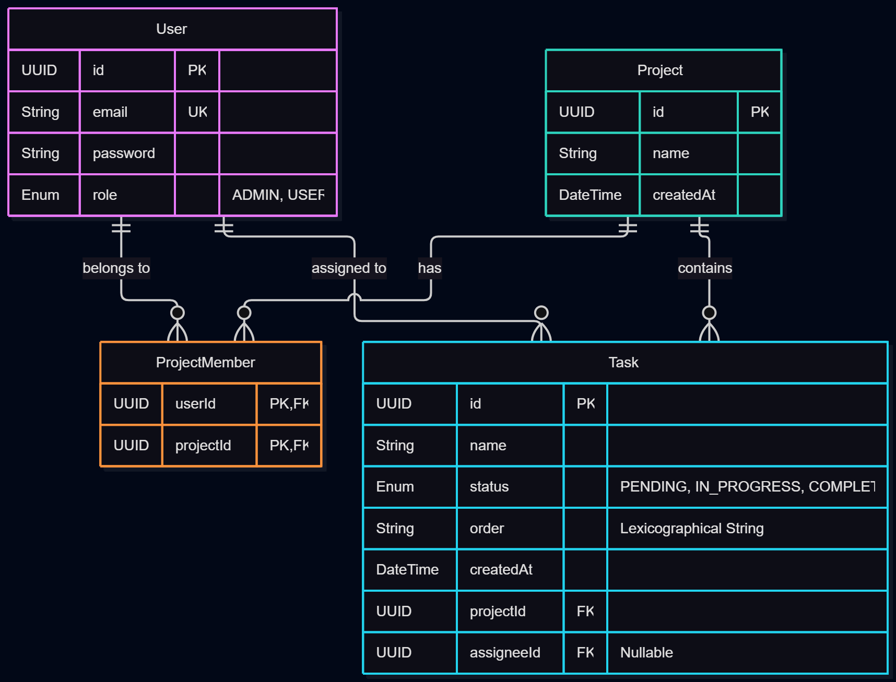

# Database Schema

Here is the core database structure for the task management app. I kept it lean to focus purely on the assessment requirements.

- Users: Handles login credentials and RBAC roles (Admin vs User).
- Projects: Basic project details. 
- ProjectMembers: A junction table to link users and projects (many-to-many), just in case we need project-specific roles later.
- Tasks: Linked to a project and assigned to a user. Status tracks Pending, In Progress, or Completed.

Note: So, as per my research on Task Ordering at [This Source](https://softwareengineering.stackexchange.com/questions/95431/priority-list-of-tasks-stored-in-a-database) : I am using Lexicographical Fractional Indexing (LexoRank) using a string field called 'order'. Standard integer arrays would force me to update every single row in the database on a drag-and-drop. By using strings (like 'a', 'b', 'c', and finding 'am' in between), I achieve O(1) updates. Only the task that was moved gets updated in the database.

Here is the visual mapping:

My other resources:
- [Deep Dive in Lexo Rank](https://medium.com/@muhebollah.diu/lexorank-the-string-trick-that-replaces-thousands-of-database-writes-2da4ef21e38a)